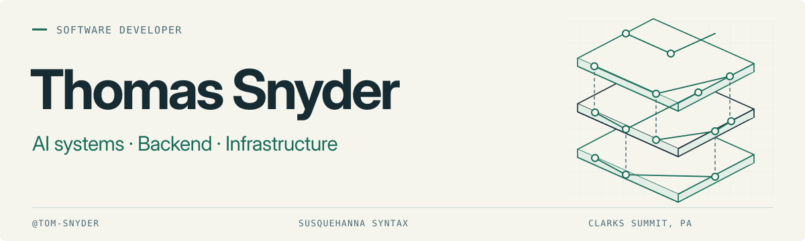
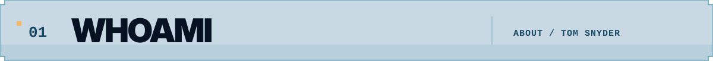
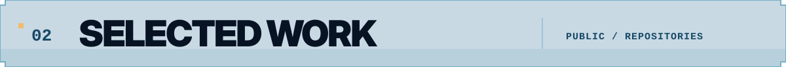
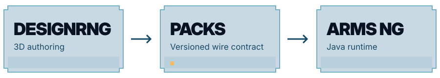

<picture>
  <source media="(prefers-color-scheme: dark)" srcset="assets/banner-dark.svg">
  <source media="(prefers-color-scheme: light)" srcset="assets/banner-light.svg">
  
</picture>

<h2><picture>
  <source media="(prefers-color-scheme: dark)" srcset="assets/section-whoami-dark.svg">
  <source media="(prefers-color-scheme: light)" srcset="assets/section-whoami-light.svg">
  
</picture></h2>

I'm **Tom Snyder**, a software developer in Clarks Summit, Pennsylvania. I work across AI systems, backend engineering, and infrastructure, and build with [Susquehanna Syntax](https://github.com/Susquehanna-Syntax). I like software I can run myself, interfaces somebody has thought about, and understanding how the pieces fit together.

My Minecraft work is a good example of how this tends to go. Procedural weapons need reusable parts. The parts need an authoring tool. The authoring tool needs a 3D editor, a Python export pipeline, and a versioned contract with a separate Java runtime. At this point the game has acquired an architecture department. The department has published its decisions, agreed on a vocabulary, and established compatibility checks. All of this is in service of putting a different gun in a game where a tree is six rectangles.

I still call it a Minecraft project. That is technically accurate, and much easier to explain than why the imaginary weapons have a governance structure.

```text
building  →  Anvil · DesignRNG · Arms NG
focus     →  local AI · backend · infrastructure
based     →  Clarks Summit, Pennsylvania
with      →  Susquehanna Syntax
```

<h2><picture>
  <source media="(prefers-color-scheme: dark)" srcset="assets/section-work-dark.svg">
  <source media="(prefers-color-scheme: light)" srcset="assets/section-work-light.svg">
  
</picture></h2>

### [Anvil](https://github.com/Susquehanna-Syntax/Anvil) · security tooling

A self-hosted security project for Linux servers and code repositories. Deterministic scanners find candidates; the remediation workflow is designed to use local models to propose patches for review, with findings and proposals tied to their evidence.

**In development.** Model patch quality and live dynamic validation remain unmeasured.

<sub>Go · Linux · SQLite · SARIF · <a href="https://github.com/Susquehanna-Syntax/Anvil#what-it-does">Read the approach ↗</a></sub>

### [DesignRNG](https://github.com/tom-snyder/DesignRNG) · 3D authoring

A desktop 3D editor for reusable parts, snap points, and procedurally generated content packs. Electron and React Three Fiber handle the editor; a Python sidecar handles validation and export. Design decisions are recorded as ADRs, including the transition from the legacy compatibility path to native authoring ownership.

<sub>TypeScript · Electron · React Three Fiber · Python · <a href="https://github.com/tom-snyder/DesignRNG/tree/main/docs/adr">Design decisions ↗</a></sub>

### [Arms NG](https://github.com/tom-snyder/Arms-NG) · procedural runtime

The Minecraft Forge runtime that consumes those packs and assembles weapons from authored parts. It ships no built-in authorable content. The editor and runtime share a versioned wire contract, with fixtures and schema checks keeping the two sides aligned.

<sub>Java · Minecraft Forge · Gradle · <a href="https://github.com/tom-snyder/Arms-NG/blob/main/docs/COMPATIBILITY_CONTRACT.md">Wire contract ↗</a></sub>

<picture>
  <source media="(prefers-color-scheme: dark)" srcset="assets/pipeline-dark.svg">
  <source media="(prefers-color-scheme: light)" srcset="assets/pipeline-light.svg">
  
</picture>

<h2><picture>
  <source media="(prefers-color-scheme: dark)" srcset="assets/section-lab-dark.svg">
  <source media="(prefers-color-scheme: light)" srcset="assets/section-lab-light.svg">
  
</picture></h2>

I’m working on **local model serving, agent routing, and evaluation**. I want to know which parts of an AI system improve the result, how much they cost, and whether the extra complexity earns its place.

I’ve started treating new boxes on an architecture diagram like job applicants. What do you do? Can you demonstrate it? Could one of the boxes already here do the same job? The résumé can be excellent: specialist knowledge, thoughtful reasoning, a reassuring number of parameters. Then the interview starts, and sometimes a much smaller baseline finishes the task while the candidate is still explaining its approach. I’m happy to admire the research. The GPU has a limited number of desks, though, and “looks impressive in the org chart” isn’t a job description.

Some of this work is still private. I’ll add more projects here as they become public.

<h2><picture>
  <source media="(prefers-color-scheme: dark)" srcset="assets/section-stack-dark.svg">
  <source media="(prefers-color-scheme: light)" srcset="assets/section-stack-light.svg">
  
</picture></h2>

| Area | Tools |
| :--- | :--- |
| Languages | Python · Java · TypeScript · Go |
| Applications | Electron · React · React Three Fiber · three.js · Zustand · Vite |
| Backend | ASGI / Uvicorn · JSON-RPC · SQLite · REST |
| Infrastructure | Linux · systemd · GitHub Actions |
| Verification | pytest · Vitest · shared fixtures · schema checks |

I write down decisions, keep a glossary for the domain, and test the boundaries between components. I also care about the interface: how a tool behaves and how it feels to use are both part of the work.

<h2><picture>
  <source media="(prefers-color-scheme: dark)" srcset="assets/section-elsewhere-dark.svg">
  <source media="(prefers-color-scheme: light)" srcset="assets/section-elsewhere-light.svg">
  
</picture></h2>

Modded Minecraft, 3D tools, and interface design. **DUSKLINE/32** is the visual thread I’m carrying through my setup: coastal navy, blue-hour glass, pixel edges, and a little amber.

<sub>Clarks Summit, PA · <a href="https://github.com/Susquehanna-Syntax">Susquehanna Syntax</a> · <a href="mailto:xtommygunzz@gmail.com">Get in touch</a></sub>
