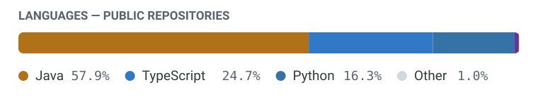

  <picture>
    <source media="(prefers-color-scheme: dark)" srcset="assets/banner-dark.svg">
    <source media="(prefers-color-scheme: light)" srcset="assets/banner-light.svg">
    
  </picture>

**Software developer working across application, backend, and infrastructure layers.**
Currently focused on self-hosted systems and local model serving.

Clarks Summit, PA · Member of <a href="https://github.com/Susquehanna-Syntax">Susquehanna Syntax</a>

---

### Selected work

#### [DesignRNG](https://github.com/tom-snyder/DesignRNG) — desktop authoring tool

An Electron desktop application for authoring procedurally-generated content packs.
The 3D editor is built on React Three Fiber — transform gizmos with legal-angle
rotation, face-resize handles, and a snap-point editor that defines where each part
docks on a chassis. A Python sidecar speaks JSON-RPC to the renderer and owns schema
validation and packaged export, which keeps the domain logic out of the UI process.

Decisions are recorded as **8 architecture decision records**, with supersession
tracked when a decision replaces an earlier one.

#### [Arms NG](https://github.com/tom-snyder/Arms-NG) — JVM runtime

The runtime that consumes those packs — a Minecraft Forge mod that composes weapons
from authored parts at load time. It ships **no built-in content**: everything is
resolved from the pack on disk.

#### The part that matters

These are two separate programs, in two languages, maintained in two repositories.
What connects them is a **versioned wire schema** with its own fixtures and a
drift check that runs in CI, so a change to the authoring side cannot silently
break the runtime. Designing and holding that contract is the work I'd point to first.

---

### Languages

<picture>
  <source media="(prefers-color-scheme: dark)" srcset="assets/stack-dark.svg">
  <source media="(prefers-color-scheme: light)" srcset="assets/stack-light.svg">
  
</picture>

| | |
|---|---|
| **Languages** | Python · Java · TypeScript · JavaScript · GLSL · Bash / PowerShell |
| **Application** | Electron · React · React Three Fiber · three.js · Zustand · Vite · PySide6 / Qt |
| **Backend** | ASGI / Uvicorn · httpx · JSON-RPC · SQLite · REST |
| **JVM** | Java 25 · Gradle (Groovy + Kotlin DSL) |
| **Infrastructure** | Linux · Raspberry Pi OS · systemd · image builds · GitHub Actions |
| **Testing** | pytest · Vitest · fixture + schema-drift verification |

---

### Current focus

**Self-hosted model serving.** A provider-agnostic broker exposing one
Anthropic-Messages-compatible API, routing requests to hosted APIs or local CLI
agents, with preflight guardrails, run history, and a small companion UI. Target
deployment is a Raspberry Pi Zero 2 W running Pi OS Lite.
*Status: working skeleton — not yet deployed.*

**GPU hardware evaluation.** Assessing RTX 3090-class hardware as the basis for a
local inference server, starting with a single GPU before deciding whether to expand.
*Status: evaluating — nothing purchased, benchmarked, or deployed.*

### How I work

- **Architecture decision records** — decisions written down and locked, supersession tracked
- **A domain glossary per project** — one agreed word per concept, so naming stays stable
- **Versioned wire contracts** — cross-language boundaries specified, fixture-tested, drift-checked
- **CI and release automation** — GitHub Actions for tests, schema checks, and packaged builds

### Contact

[Email](mailto:xtommygunzz@gmail.com)

Some of my work is in private repositories.
